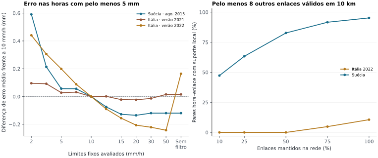

# Reprodução da validação europeia

O [diário](../2026-11-20-validacao.md) registra as regras propostas, os resultados e quando cada extensão foi acrescentada. As métricas são de estimativa retrospectiva de chuva horária em células associadas a pluviômetros independentes.

## Dados e execução

Use Python 3.12 e instale as dependências em um ambiente virtual. Os scripts foram executados em CPU. As medições de tempo do diário incluem apenas as etapas indicadas. Separe cerca de 5 GB por coleção descompactada. É possível preparar uma coleção por vez e conservar os NetCDF menores de pares horários.

```bash
python -m venv .venv
. .venv/bin/activate
python -m pip install -r requisitos-validacao.txt
export OPENBLAS_NUM_THREADS=1 OMP_NUM_THREADS=1
```

Baixe o `OpenMRG.zip` da versão 1.1, confirme o MD5 `4e4cdf6ced4d45a084c348f245b8d690` e descompacte o arquivo em `dados/suecia`. O diretório deve conter `cml/cml.nc`, `radar/radar.nc` e `gauges`. O script italiano extrai dos TAR da versão 2.0 apenas os meses escolhidos. [OpenMRG 1.1](https://zenodo.org/records/7107689) · [OpenRainER 2.0](https://zenodo.org/records/14731404)

```bash
python preparar_validacao.py sweden dados/suecia suecia.nc
python obter_italia.py dados/italia2022 202206 202207 202208
python preparar_validacao.py italy dados/italia2022 italia2022.nc
python obter_italia.py dados/italia2021 202106 202107 202108
python preparar_validacao.py italy-2021 dados/italia2021 italia2021.nc
```

A preparação usa as funções `pycomlink` de linha de base, perda por antenas molhadas e conversão para chuva. A etapa KED usa o variograma e os parâmetros da comparação publicada. Os índices de 10 segundos da Suécia foram reduzidos por blocos para evitar carregar o NetCDF de 4,63 GB inteiro na memória. Os comparadores usam a média dos subenlaces. O índice `link_disagreement` usa a diferença entre os dois sentidos disponíveis. [Notebooks da comparação original](https://github.com/OpenSenseAction/radar_adjustment_intercomparison/tree/v1.0.0) · [Artigo](https://doi.org/10.5194/hess-30-7007-2026)

```bash
python avaliar_validacao.py suecia.nc sweden suecia.csv
python avaliar_validacao.py italia2022.nc 'IT verão 2022' italia2022.csv --fixed fixo_10 --extended
python avaliar_validacao.py italia2021.nc 'IT verão 2021' italia2021.csv --fixed fixo_10 --extended
python avaliar_ked.py italia2021.nc 'IT 2021' bloco italia2021-ked.csv --directional
python avaliar_deteccao.py italia2022.nc italia2021.nc deteccao.csv
python testar_densidade.py suecia.nc SE fixo_10 suecia-densidade.csv
python diagnosticar_limites.py italia2022.nc 'IT 2022' italia2022-limites
python diagnosticar_enlaces.py italia2021.nc 'IT 2021' italia2021-enlaces.csv
```

`comparar_campos.py` aceita também os mapas publicados de fusão aditiva (`add_IDW`) e KED em blocos (`lked`), além do NetCDF preparado com os pares. Os scripts `checar_idw.py` e `checar_ked.py` usam o recorte OpenMRG de oito dias em `data/` e o arquivo `suecia_amostra_pares.nc` do modo `sweden-sample`. [Campos publicados](https://doi.org/10.5281/zenodo.23367571) · [Recorte OpenMRG](https://github.com/OpenSenseAction/opensense_example_data/tree/b4266fa5603a4791302b2b11fcff5d2ffc6cdee0/OpenMRG)

## Tabelas

- [Métricas dos comparadores, filtros e campos publicados](metricas-principais.csv)
- [Sensibilidade à remoção de enlaces](densidade-resumo.csv)
- [Comparação entre limites fixos](limites-fixos.csv)
- [Detecção com cortes calibrados em 2022 e verificados em 2021](italia_deteccao.csv)

`eam_5` e `eam_10` são erros absolutos médios condicionados a pelo menos 5 mm e 10 mm observados na hora, respectivamente. A taxa de falsos alarmes é a fração dos pares abaixo de 5 mm observados que excedem o corte previsto. Os campos `delta_ic025` e `delta_ic975` vêm da reamostragem de eventos completos. Ficam vazios quando há menos de dez eventos.

## Figura



No gráfico da esquerda, os pontos são os limites fixos da grade de sensibilidade. O da direita mostra a mediana das remoções aleatórias na fração de observações enlace–hora que conservou oito vizinhos válidos em 10 km. [Código da figura](figura_validacao.py)

### Mediana espacial na correção multiplicativa

Use os pares preparados de cada base e o mesmo rótulo no relatório. O rótulo `SE agosto` seleciona agosto de 2015 para avaliação. O parâmetro `--period 24` repete a análise com fatores de 24 horas.

```bash
python testar_mediana_multiplicativa.py suecia_verao_pares.nc 'SE agosto' mediana-se.csv
python testar_mediana_multiplicativa.py italia_2021_pares.nc 'IT 2021' mediana-it-2021.csv
python testar_mediana_multiplicativa.py italia_verao_pares.nc 'IT 2022' mediana-it-2022.csv
python testar_mediana_multiplicativa.py ../nova-york/maio-junho.nc 'NYC maio–junho' mediana-nyc.csv
```

[Métricas horárias e diárias](mediana-multiplicativa.csv)
